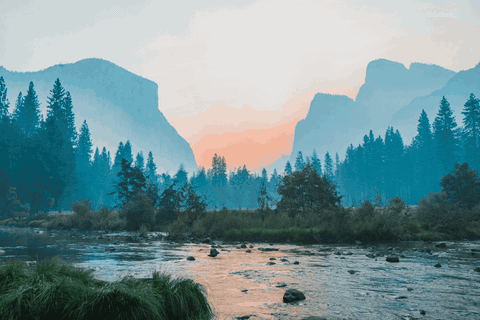

# Films from a picture

*One ordinary photo, filmed. The valley photo is from Unsplash.*

A side feature. The main use of this skill is building a scene from words: see SKILL.md. Use this only when the user hands you a picture and wants that exact picture to move.

Run every command from this skill's folder, as `node bin/depth-diorama.mjs <command>`. The first `film` downloads a depth model once (about 100 MB).

The tool does the heavy work. You are the director: you look at the picture, choose the move, the framing and the words, and judge the result before the user sees it.

1. **Look at the picture** with your own eyes first. What is the subject? Where will it be shown?
2. **`film <picture> --stills`** with your choices. It takes a few seconds, prints what it found (layers, subject, framing) and writes key frames plus `sheet.png`. **Open the sheet and judge it** against the list below.
3. Change options and repeat step 2 until it is right. Two or three rounds is normal.
4. **`film <picture>`** with the same options renders the final video (one to three minutes) and checks it. Use `--draft` first if you want to see motion quickly (seconds, half size).
5. Give the user the video. Quote any check that failed.

### Choosing

| Decision | Options | Guidance |
|---|---|---|
| Shape | `--aspect auto` (the picture's shape), `16:9`, `9:16`, `1:1`, `4:5`, `all` | 9:16 for Reels, Shorts, TikTok. 4:5 or 1:1 for feeds. |
| Move | `--move reveal`, `push`, `orbit`, `rise`, `slide` (run `moves` for descriptions) | Products: `reveal` or `orbit`. Portraits: `orbit`, with `--motion 0.7`. Landscapes and interiors: `push`. Things seen from above: `rise`. Wide groups: `slide`. |
| Strength | `--motion 0.2-2` (camera travel), `--depth 0-2.5` (how far layers stand apart) | Lower both when edges smear or faces bend. Raise them for flat artwork that needs help. |
| Framing | `--fit auto`, `cover` (fill the frame, crop the picture), `contain` (keep the whole picture, paint in the rest) | Painting in works on plain or soft backgrounds. On busy ones use `cover`. |
| Focus | `--focus 0-1` (0 far, 1 near), `--blur 0-2` | The camera turns around this depth and keeps it sharp. Set it only if the wrong thing stays still. |
| Layers | `--layers 1-6` | A cap. Use 1 to move the picture as a single surface when cut-outs look wrong. |
| Words | `--title "TWO|LINES"`, `--subtitle`, `--title-at top|middle|bottom|0-1`, `--title-depth behind|front`, `--title-color`, `--title-size`, `--font` | `|` breaks lines. By default the title stands behind the subject, so the subject passes in front of it. Keep titles to one to three short words a line. |
| Length | `--duration 3-30` (default 8), `--fps`, `--format mp4|webm`, `--out <file or folder>` | Every film loops without a seam. |

A custom move is a list of keys, each `[phase, swing, tilt, distance, zoom]`: `--move '[[0,0,0,1,1],[0.3,14,4,0.6,1.05],[0.7,-12,2,0.65,1.03]]'`. Phase runs 0 to 1, swing up to 40 degrees and tilt up to 30, distance 1 is the start and smaller is closer. The first key must be `0,0,0,1,1`.

### Judging the stills

- **Edges of the subject.** Smears, halos or a doubled outline mean too much travel. Lower `--motion` or `--depth`.
- **Faces and straight lines.** If they bend, lower `--depth`, or use `orbit`.
- **Painted-in areas.** Look where the background was hidden and at frame edges. If it looks smudged, use `--fit cover`, a gentler move, or fewer `--layers`.
- **The title.** Readable in every frame, not cut off, not covering the subject's key feature. Move it with `--title-at`, or bring it to the `front`.
- **The wrong thing is the hero.** Set `--focus` to the depth of the real subject (the printed description gives the depths of the cuts).

### What suits it and what does not

Best: one clear subject with space behind it. Good: landscapes, interiors, illustrations with layers. Weak: flat documents and charts (use `--layers 1 --motion 0.5` for a gentle drift), fine hair or fences against busy backgrounds, mirrors and glass. A transparent PNG is placed on white.

### Checks

Each render confirms that the film starts on the untouched picture, that no empty gaps show at any angle, and that the video has no freezes, pops, flicker or visible loop seam. A report and a contact sheet are written beside the video.

Exit codes: 0 ok, 1 checks failed, 2 bad command, 3 machine not ready, 4 scene error.
