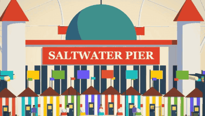

<div align="center">

# Depth Diorama

**Describe a place. Get a flat poster that shatters into a 3D world.**


*That whale is one painting, split across dozens of buildings more than 100 metres apart.*

</div>

<br>

## Try it

You need Claude Code, Node 20+ and ffmpeg.

```bash
git clone https://github.com/hardikverma22/depth-diorama ~/.claude/skills/depth-diorama
cd ~/.claude/skills/depth-diorama && npm install && node bin/depth-diorama.mjs setup
```

Then ask Claude Code for one:

> Make a depth diorama of a rainy night market, vertical for Reels.

Claude builds the place, checks how it looks and renders the video. No 3D software, no footage, no timeline.

**See it without AI.** This writes one HTML file. Open it and drag the bar slowly:

```bash
node bin/depth-diorama.mjs share whale
```

<br>

## Made with it

<table>
<tr>
<td width="33%"></td>
<td width="33%"></td>
<td width="33%"></td>
</tr>
<tr>
<td align="center"><b>Pier</b><br>Ten huts in one row are really two long lines</td>
<td align="center"><b>Station</b><br>One storefront is eight kiosks down a platform</td>
<td align="center"><b>Night market</b><br>A wall of neon is a street 60 metres deep</td>
</tr>
</table>

<br>

## How the trick works

1. **Flatten.** A very long lens from far away removes all sense of depth.
2. **Hide.** While the picture is flat, objects quietly change position.
3. **Open.** The camera moves in as the lens widens, and the poster becomes a place.

<br>

## What you get

| | |
|---|---|
| **Frame shapes** | 16:9, 9:16, 1:1 and 4:5, each framed automatically |
| **Looks** | `day`, `dusk`, `night` or `rain`, in one word |
| **Output** | MP4, WebM, or a draggable HTML page |
| **Quality checks** | Every render is tested for flatness, real depth, loop seams, pops, freezes and flicker |

<br>

## Commands

```
stills    a picture of each key moment       share     a draggable HTML player
preview   a fast half-size video             verify    check a scene or any video
render    a full-quality video               doctor    check this machine can render
```

MIT licensed.
