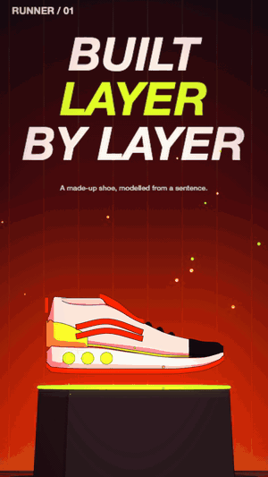
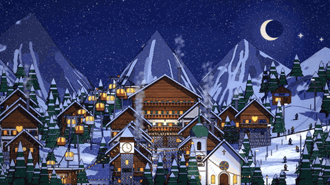
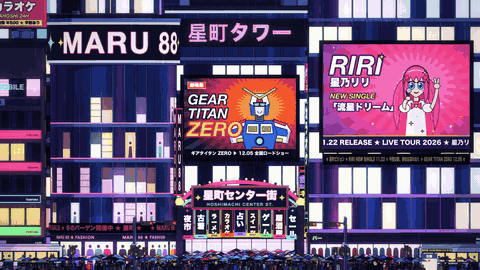
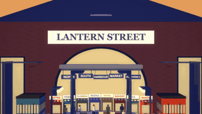
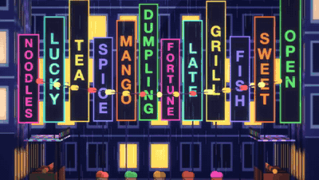

<div align="center">

# Depth Diorama

**Type a sentence. Get back a film with a real moving camera.**



*"A running shoe that comes apart layer by layer." No photo, no 3D model, nothing drawn by hand.*

</div>

<br>

## One sentence each

Each film below was made by a fresh Claude Code agent that was given only the sentence under it and this skill. It used no pictures, no templates and no image generator. It wrote the scene, reviewed its own stills over several rounds, and rendered once every check passed.



> A mountain ski village at night in falling snow: wooden chalets with glowing windows climbing the slope, a gondola lift with cabins gliding up to the peak, skiers coming down a lit piste, a small clock tower and a church spire in the square, string lights across the lane, a frozen pond where people skate, pine trees heavy with snow, and the mountain under a starry sky.



> A rainy scramble crossing in a Tokyo-style shopping district at dusk. Tall buildings covered in neon signs and giant video screens (a pop-idol ad and an anime robot ad), a lit gateway over the shopping street, a round glass tower on the corner, crowds with umbrellas crossing in every direction, buses and taxis waiting, traffic lights, and a wet road reflecting the neon.

<br>

## How it works

A skill for Claude Code. You describe what you want; Claude writes a small 3D scene from your words; the engine films it.

Every film opens as a flat illustrated poster. A very long lens makes the deep scene look printed. Then the camera flies in, the lens widens and the poster opens into a world: it circles, rises and dips while things in the scene move, come apart and light up. It ends back on the poster, so it loops.

## Try it

You need Claude Code, Node 20+ and ffmpeg.

```bash
git clone https://github.com/hardikverma22/depth-diorama ~/.claude/skills/depth-diorama
cd ~/.claude/skills/depth-diorama && npm install && node bin/depth-diorama.mjs setup
```

Then ask Claude Code:

> Make a depth diorama reel of a vintage camera that opens up to show its parts, vertical for Reels.

> A rainy night market that opens from a neon poster, 16:9.

Claude builds the scene, looks at stills, fixes what is weak, and only then renders and checks the film.

## What you can make

| | |
|---|---|
| **Product reels** | Your object on a plinth, circled 360° while it explodes into labelled parts |
| **Places** | Streets, piers, platforms and markets that open from a poster into a deep world |
| **Animated posters** | One big image that breaks apart into the scene it was painted from |
| **Title sequences and loops** | Any length from 4 to 30 seconds, seamless |

| | |
|---|---|
| **Camera** | Six ready-made choreographies, or any path the agent writes: dives, orbits, crane shots, low angles |
| **Look** | Ink outlines, two-tone shading, hatching, point lights, wet reflections, bloom, film-style motion blur, and weather (snow, embers, petals, dust). Day, dusk, night, rain and studio light |
| **Shapes** | 16:9, 9:16, 1:1, 4:5 |
| **Output** | MP4 or WebM, 60 frames a second, with a contact sheet and a report |
| **Checks** | Every film is tested for depth, framing, a camera that never passes through anything, freezes, pops, flicker and a visible loop seam |

<table>
<tr>
<td width="33%"></td>
<td width="33%"></td>
<td width="33%"></td>
</tr>
</table>

See it without AI. This writes one HTML file; open it and drag the bar slowly:

```bash
node bin/depth-diorama.mjs share runner
```

The workflow is in [SKILL.md](SKILL.md) and the scene kit in [SCENES.md](SCENES.md). There is also a side command that moves an existing picture: [PICTURES.md](PICTURES.md).

<br>

MIT licensed.
